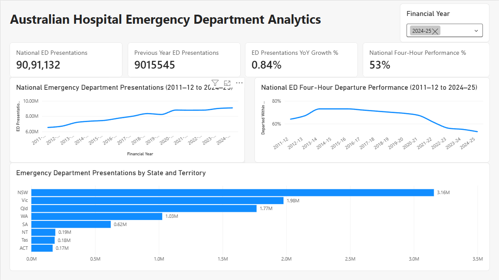
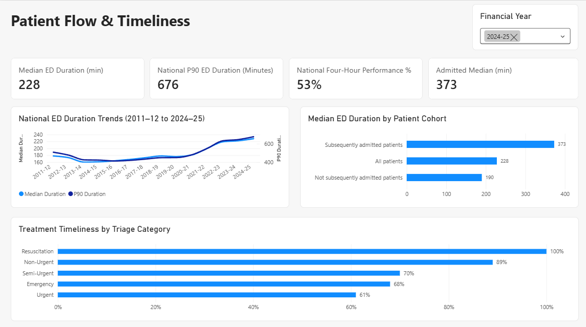
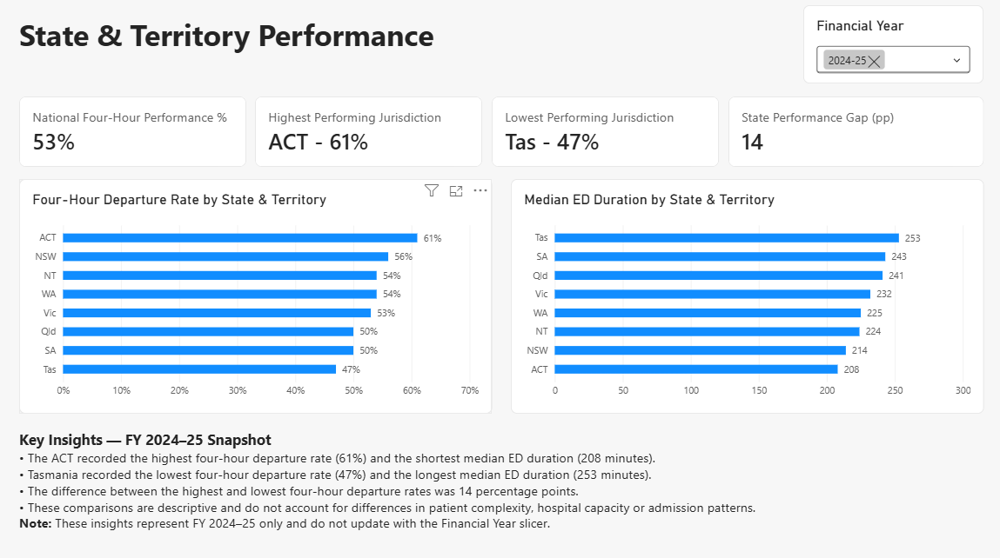

<div align="center">

# Australian Hospital Emergency Department Analytics

### Healthcare Performance Analytics | Python · MySQL · Power BI


**Australian Hospital ED Performance | FY 2011–12 to FY 2024–25 | Three-Page Power BI Report**

An end-to-end analysis of emergency department demand, patient flow, treatment timeliness, and performance across Australian states and territories.

</div>

---

## Dashboard Preview



*ED overview showing national presentations, year-on-year growth, historical performance, and state comparisons.*

**[Explore all three dashboard pages](#power-bi-dashboards)**

---

## Project Navigation

[Overview](#project-overview) · [Objectives](#project-objectives) · [Data Sources](#data-sources) · [Methodology](#project-methodology) · [Findings](#key-analytical-findings) · [Dashboards](#power-bi-dashboards) · [Validation](#sql-data-validation-results) · [Run the Project](#how-to-run-the-project)

---

## Key Metrics at a Glance

| FY 2024–25 Indicator | Result |
|---|---:|
| **National ED Presentations** | **9,091,132** |
| **Four-Hour Departure Performance** | **53%** |
| National Median ED Duration | 228 minutes |
| National P90 ED Duration | 676 minutes |
| Annual Presentation Growth | 0.84% |

*These are reported values from the project's analysis; definitions, scope, and limitations appear below.*

---

## Project Overview

This project examines Australian hospital emergency department (ED) demand, patient flow, treatment timeliness, and differences in performance across states and territories.

Using publicly available Australian Institute of Health and Welfare (AIHW) statistics, the project transforms healthcare reporting data into structured analytical datasets, SQL insights, and interactive Power BI dashboards.

The analysis focuses on identifying long-term performance trends, understanding patient duration patterns, and communicating findings to support evidence-informed decision-making.

## Project Objectives

- Analyse historical emergency department presentation volumes.
- Measure year-on-year changes in ED demand.
- Examine national four-hour departure performance.
- Investigate median and 90th-percentile ED durations.
- Compare emergency department performance across states and territories.
- Analyse patient duration by admission outcome.
- Evaluate treatment timeliness across triage categories.
- Compare eligible hospitals against their peer-group benchmarks.
- Develop interactive dashboards that communicate analytical findings clearly.

---

## Data Sources

This project uses publicly available emergency department statistics published by the **Australian Institute of Health and Welfare (AIHW)**.

**Reporting period:** 2011–12 to 2024–25

Four main datasets were analysed:

| Dataset | Description |
|---|---|
| ED Presentations | Emergency department presentation volumes by reporting year, jurisdiction, and reporting unit |
| Four-Hour Performance | Percentage of ED presentations departing within four hours |
| ED Waiting Times | Percentage of patients receiving treatment within the recommended time for their triage category |
| ED Duration | Median and 90th-percentile emergency department length of stay |

The source data includes national, state/territory, and hospital-level reporting records.

These reporting levels are treated separately to avoid double-counting.

**Data source:** [Australian Institute of Health and Welfare](https://www.aihw.gov.au/)

### Data Attribution and Licensing

**Data provider:** Australian Institute of Health and Welfare (AIHW)

**Reporting period:** 2011–12 to 2024–25

AIHW material is generally available under the Creative Commons Attribution 4.0 International (CC BY 4.0) licence unless otherwise specified.

Users should verify the licensing conditions of the specific source datasets before redistribution.

The data was explored, cleaned, validated, and analysed using Python, MySQL, and Power BI for educational and portfolio purposes.

This is an independent analytical project and is not affiliated with or endorsed by AIHW.

**Copyright information:** [AIHW Copyright and Licensing](https://www.aihw.gov.au/copyright)

**Dataset availability:** The original Excel workbook and cleaned CSV datasets are not included in the initial public repository. To reproduce the analysis, obtain the relevant source workbook from AIHW and follow the data preparation workflow described below.

---

## Technologies Used

| Technology | Purpose |
|---|---|
| Python | Data exploration, cleaning, transformation, and validation |
| Pandas | Data manipulation and analytical preparation |
| Matplotlib | Exploratory visualisation |
| Jupyter Notebook | Documented Python analysis workflow |
| MySQL | Relational database management and analytical querying |
| SQL | Data validation, transformations, aggregations, and analytical queries |
| Power BI | Interactive dashboards and visual reporting |
| DAX | Custom KPIs, year-on-year comparisons, and performance measures |
| Visual Studio Code | Development and project organisation |
| Git & GitHub | Version control and portfolio publication |

---

## Project Methodology

### 1. Data Exploration — Python

The original AIHW Excel workbook was explored using Python and Pandas.

Activities included:

- Examining available worksheets and reporting categories.
- Reviewing dataset structures and financial-year coverage.
- Identifying missing and non-numeric values.
- Investigating suppressed presentation counts.
- Examining national, state, and hospital reporting levels.
- Reviewing performance percentages and duration measurements.
- Preparing datasets for subsequent SQL analysis.

### 2. Data Cleaning and Preparation

Data preparation involved:

- Preserving original source values.
- Converting valid presentation counts into numeric values.
- Converting ED duration measurements into minutes.
- Handling suppressed and unavailable measurements as missing values.
- Preparing numeric treatment-timeliness and four-hour performance measures.
- Preserving data-quality caution indicators.
- Producing cleaned CSV files and MySQL-compatible import datasets.

Original and cleaned values were retained separately where appropriate to support validation and traceability.

### 3. Database Development — MySQL

A MySQL database named `australian_hospital_ed` was created to organise the analytical datasets.

The database contains four main analytical tables:

| Table | Purpose |
|---|---|
| `ed_presentations` | Emergency department presentation counts |
| `ed_waiting_times` | Treatment timeliness by triage category |
| `ed_four_hour_performance` | Four-hour ED departure performance |
| `ed_duration` | Median and 90th-percentile ED durations |

Three additional staging tables support the restoration of quality-caution indicators.

SQL scripts were developed for database creation, table definitions, data transformations, validation, and analysis.

### 4. Data Validation — SQL

Validation checks examined:

- Dataset record counts.
- Missing and suppressed values.
- Valid numeric ranges for performance percentages.
- Negative or inconsistent duration measurements.
- Duplicate reporting combinations.
- Data-quality caution indicators.
- Staging-table matching and uniqueness.

Special attention was given to ensuring national, state, and hospital records were not incorrectly combined.

### 5. Analytical Querying — SQL

Twelve analytical questions were developed to investigate:

- National emergency department presentation trends.
- Year-on-year presentation growth.
- Presentation volumes by state.
- Treatment timeliness by triage category.
- National four-hour departure trends.
- Median and P90 duration trends.
- Patient duration by admission cohort.
- Four-hour performance by patient cohort.
- State and territory performance comparisons.
- Hospital performance against peer-group benchmarks.
- Distribution of hospitals above and below benchmarks.
- Below-benchmark performance by hospital peer group.

The analysis uses SQL aggregations, Common Table Expressions (CTEs), window functions, conditional logic, and appropriate missing-value handling.

### 6. Data Modelling — Power BI

Four analytical tables were imported into Power BI.

A shared financial-year dimension, `Dim_FinancialYear`, was created and connected to the four reporting tables using active one-to-many relationships with single-direction filtering.

DAX measures were developed for:

- National ED presentations.
- Previous-year presentations.
- Year-on-year growth.
- National four-hour departure performance.
- National median and P90 ED durations.
- Admitted-patient median duration.
- State-level performance comparisons.
- Highest- and lowest-performing jurisdictions.
- State performance gap in percentage points.

### 7. Dashboard Development — Power BI

Three interactive dashboards were created:

1. **ED Overview:** National presentation volumes, year-on-year growth, historical trends, and state comparisons.
2. **Patient Flow & Timeliness:** ED durations, patient cohorts, and treatment timeliness.
3. **State & Territory Performance:** Jurisdictional four-hour departure rates, median durations, performance gaps, and key insights.

Financial-year slicers support historical comparisons, while selected trend charts intentionally retain the full reporting period.

---

## Key Analytical Findings

### 1. Emergency Department Demand Increased

- National ED presentations increased from **6,538,221 in 2011–12** to **9,091,132 in 2024–25**.
- This represents an increase of approximately **39%** across the reporting period.
- Presentations increased from **9,015,545 in 2023–24** to **9,091,132 in 2024–25**.
- The latest year-on-year growth rate was **0.84%**.

### 2. Four-Hour Departure Performance Declined

- National four-hour departure performance was **64% in 2011–12**.
- Performance reached approximately **73% between 2013–14 and 2015–16**.
- By 2024–25, the national rate had declined to **53%**.
- Performance decreased from **55% in 2023–24** to **53% in 2024–25**, representing a decline of **2 percentage points**.

### 3. Emergency Department Durations Increased

- National median ED duration increased from **178 minutes in 2011–12** to **228 minutes in 2024–25**.
- National P90 duration increased from **508 minutes** to **676 minutes** over the same period.

For 2024–25:

| Patient Cohort | Median ED Duration |
|---|---:|
| Subsequently admitted patients | 373 minutes |
| All patients | 228 minutes |
| Not subsequently admitted patients | 190 minutes |

Subsequently admitted patients recorded longer median ED durations than patients who were not subsequently admitted.

### 4. Performance Varied Across Jurisdictions

For FY 2024–25:

| State or Territory | Four-Hour Departure Rate |
|---|---:|
| ACT | 61% |
| NSW | 56% |
| NT | 54% |
| WA | 54% |
| Victoria | 53% |
| Queensland | 50% |
| South Australia | 50% |
| Tasmania | 47% |

The **ACT recorded the highest rate at 61%**, while **Tasmania recorded the lowest at 47%**.

The difference between the highest and lowest jurisdictions was **14 percentage points**.

Median ED durations also varied:

- **Tasmania:** 253 minutes, the longest state-level median.
- **ACT:** 208 minutes, the shortest state-level median.

These comparisons are descriptive and should not be interpreted as direct measures of hospital quality.

### 5. Treatment Timeliness Differed by Triage Category

For FY 2024–25:

| Triage Category | Patients Seen on Time |
|---|---:|
| Resuscitation | 100% |
| Non-Urgent | 89% |
| Semi-Urgent | 70% |
| Emergency | 68% |
| Urgent | 61% |

Each triage category has a different recommended treatment-time target. Results should therefore be interpreted against the relevant clinical threshold.

### 6. Hospital Peer-Group Benchmark Analysis

Eligible hospitals were compared against their published peer-group four-hour performance benchmarks.

The analysis included hospitals with:

- At least 1,000 ED presentations in FY 2024–25.
- Valid performance percentages.
- Valid peer-group benchmarks.
- No data-quality caution flag.
- Records belonging to the All patients cohort.

Results included:

| Hospital Peer Group | Eligible Hospitals | Below Benchmark |
|---|---:|---:|
| Major hospitals | 31 | 58.06% |
| Large metropolitan hospitals | 30 | 56.67% |
| Children's hospitals | 6 | 50.00% |
| Medium regional hospitals | 23 | 47.83% |
| Large regional hospitals | 30 | 46.67% |
| Medium metropolitan hospitals | 22 | 40.91% |
| Small hospitals | 65 | 32.31% |

Major hospitals had the highest proportion of eligible hospitals below their respective peer-group benchmarks.

These comparisons reflect performance against different peer-group benchmarks and do not establish that one peer group provides worse overall care.

### Overall Interpretation

The analysis identifies increasing emergency department demand alongside declining four-hour departure performance and longer ED durations over the reporting period.

Variations across patient cohorts and jurisdictions demonstrate important differences in reported emergency department performance.

However, these findings are descriptive and do not independently establish causation or account for patient complexity, hospital capacity, admission patterns, or other operational factors.

---

## Power BI Dashboards

Three interactive Power BI dashboard pages were developed to communicate the analytical findings.

### 01 — ED Overview

Displays national emergency department presentations, year-on-year growth, four-hour departure performance, historical trends, and state-level presentation volumes.


### 02 — Patient Flow & Timeliness

Analyses median and 90th-percentile ED durations, patient-cohort differences, historical duration trends, and treatment timeliness by triage category.



### 03 — State & Territory Performance

Compares four-hour departure rates and median ED durations across eight Australian states and territories.

Includes the highest- and lowest-performing jurisdictions, performance differences, and a fixed FY 2024–25 insights summary.



### Dashboard Features

- Interactive financial-year slicers.
- KPI cards using custom DAX measures.
- Historical performance trend analysis.
- State and territory comparisons.
- Patient-cohort analysis.
- Triage-category performance comparisons.
- Dynamic jurisdictional performance indicators.
- Clearly documented reporting limitations.

---

## SQL Data Validation Results

Validation was performed using MySQL queries to examine data completeness, consistency, and quality-caution records.

### Record Counts and Quality Flags

| Dataset | Total Records | Quality-Caution Records |
|---|---:|---:|
| ED Waiting Times | 21,972 | 385 |
| Four-Hour Performance | 36,289 | 306 |
| ED Duration | 13,611 | 94 |

For the duration dataset, 94 records had both median and P90 quality-caution indicators set to True.

### Quality-Caution Staging Checks

| Staging Table | Flagged Records | Duplicate Matching-Key Groups |
|---|---:|---:|
| Waiting-Time Staging | 385 | 0 |
| Four-Hour Staging | 306 | 0 |
| ED Duration Staging | 94 | 0 |

The checks found no duplicate matching-key groups in the three caution staging tables.

All waiting-time and four-hour staging records matched analytical records with the corresponding caution flags set.

The duration dataset's 94 flagged records were also consistent with the staging counts.

These checks support the internal consistency of the imported datasets but do not independently verify completeness against the original AIHW source.

For additional details, see:

[SQL Validation Summary](Docs/SQL_Validation_Summary.md)

---

## Data Quality and Limitations

### Missing and Suppressed Values

Source values such as `NP`, `<5`, and `-` were retained in their original form.

Unavailable or suppressed numeric measurements were represented as missing values rather than automatically converted to zero.

### Quality-Caution Indicators

Separate Boolean quality-caution indicators were preserved for applicable performance and duration measurements.

The staging tables use an exception-only approach, in which flagged records are retained and matching caution indicators are applied to the analytical tables.

### Reporting-Level Consistency

National, state/territory, and hospital records are distinguished to avoid double-counting.

Published aggregate percentages, medians, and percentiles are retrieved directly where appropriate.

### Statistical Limitations

Median and percentile values are non-additive measures and should not be averaged across hospitals to calculate national statistics.

Performance comparisons are descriptive and do not account for all differences in hospital size, patient complexity, service capacity, or clinical circumstances.

### Dashboard Limitations

- Historical trend charts display the full 2011–12 to 2024–25 reporting period.
- Other visuals respond to financial-year selection.
- The State & Territory Performance page includes fixed FY 2024–25 insights that do not change with the slicer.
- Hospital peer-group analyses use a minimum threshold of 1,000 presentations as an analytical choice.

---

## Project Structure

```text
Australian-Hospital-ED-Analytics/
|
|-- README.md
|-- .gitignore
|-- requirements.txt
|
|-- Data/
|   |-- Original AIHW workbook
|
|-- Data_Cleaned/
|   |-- Cleaned and MySQL-compatible CSV datasets
|
|-- Notebook/
|   |-- 01_data_exploration.ipynb
|
|-- SQL/
|   |-- 01_database_setup.sql
|   |-- 02_create_tables.sql
|   |-- 03_data_validation.sql
|   |-- 04_data_analysis.sql
|   |-- 05_data_transformations.sql
|   |-- SQL_Analysis_Findings.md
|
|-- PowerBI/
|   |-- Australian_Hospital_ED_Analytics.pbix
|
|-- Screenshots/
|   |-- 01_ED_Overview.png
|   |-- 02_Patient_Flow_Timeliness.png
|   |-- 03_State_Territory_Performance.png
|
|-- Docs/
|   |-- SQL_Validation_Summary.md
```

**Note:** The `Data/` and `Data_Cleaned/` directories are maintained locally and were not included in the initial GitHub commit, pending verification of the specific dataset redistribution terms.

---

## How to Run the Project

### Prerequisites

- Python 3
- Jupyter Notebook or Visual Studio Code
- MySQL 8.0 or later
- Power BI Desktop (Windows)

### 1. Clone the Repository

```bash
git clone https://github.com/vishalakula09/Australian-Hospital-ED-Analytics.git

cd Australian-Hospital-ED-Analytics
```

### 2. Install Python Dependencies

```bash
python -m pip install -r requirements.txt
```

The project uses Pandas, Matplotlib, and OpenPyXL.

### 3. Prepare the Source Data

Obtain the corresponding emergency department source workbook from AIHW.

Create a `Data/` folder in the project root and save the workbook using the filename:

```text
myhosp-emergency-department-data-extract.xlsx
```

The notebook expects this filename and folder structure.

### 4. Run the Python Notebook

Open:

```text
Notebook/01_data_exploration.ipynb
```

Run the notebook from the `Notebook/` working directory.

The notebook processes the source workbook and generates cleaned datasets in `Data_Cleaned/`.

Some notebook cells use relative paths such as `../Data_Cleaned`, so the working directory is important.

### 5. Set Up MySQL

Create and select the project database:

```text
SQL/01_database_setup.sql
```

Create the analytical and staging tables:

```text
SQL/02_create_tables.sql
```

Import the relevant cleaned CSV files and caution staging datasets into their corresponding MySQL tables.

The CSV import mappings and staging prerequisites must be verified before running the transformation script.

### 6. Execute SQL Transformations and Validation

Run:

```text
SQL/05_data_transformations.sql
```

**Important:** This script contains UPDATE statements. Execute it only after importing and verifying the required data and staging tables.

Next, validate the imported data using:

```text
SQL/03_data_validation.sql
```

Run the analytical queries using:

```text
SQL/04_data_analysis.sql
```

### 7. Explore the Power BI Dashboard

Open:

```text
PowerBI/Australian_Hospital_ED_Analytics.pbix
```

The report contains three dashboard pages and interactive financial-year slicers.

The dashboard was built using imported MySQL data. Refreshing the report may require configuring a compatible MySQL connection and updating the data-source settings.

---

## Important Notes

This project was developed for educational and professional portfolio purposes.

It is intended to demonstrate an end-to-end analytics workflow involving data exploration, preparation, SQL validation, analytical querying, data modelling, visualisation, and communication of findings.

The reported statistics should not be interpreted as causal evidence or as an assessment of individual hospital quality.

Users should consult AIHW source documentation when interpreting data definitions, missing values, quality indicators, and reporting limitations.

---

## Author

**Vishal Akula**

Master of Data Science — Deakin University

**Career Interests:** Data Analyst | Business Intelligence Analyst | Analytics

[LinkedIn](https://www.linkedin.com/in/vishal-akula-6a80a8273/)

[GitHub](https://github.com/vishalakula09)

---

<div align="center">

*Independent healthcare analytics portfolio project using publicly available Australian hospital reporting statistics.*

**Turning healthcare data into meaningful performance insights.**

</div>
